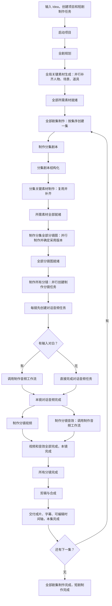

# AI 短剧工作室生产流程

本文是当前生产流程的业务依据，由具体任务类实现。调度模块设计见 [技术方案](technical-design.md)。

## 项目与生产主线

AI 短剧工作室以任务驱动内容生产。以下流程由具体任务类在运行时创建子任务并声明等待关系。

输入 Idea 创建项目时，同时创建处于等待状态的「短剧制作」任务。项目启动后，由该任务依次编排以下阶段。

1. **全剧规划**。根据 Idea 产出世界观、人物设定、分集大纲和全局关键素材清单。
2. **全局关键素材生成**。按清单并行制作全剧共用的人物、场景和道具。全部所需素材就绪后，进入剧集制作。
3. **全部剧集制作**。按集序一次派发一集。本集交付并标记完成后，再派发下一集。全部剧集交付后，「短剧制作」完成。

## 分集制作

按以下六个阶段顺序推进。

1. **制作分集剧本**。根据本集大纲生成完整剧本。
2. **分集剧本结构化**。拆出有序分镜，记录镜头所在场景、画面和动作描述、对白、音效需求及预计时长，并提取本集新增的人物、场景和道具。
3. **分集关键素材制作**。复用已经就绪的素材，按类型并行补齐缺少的人物、场景和道具。所需素材齐备后，才进入分镜图制作。
4. **制作分集全部分镜图**。为每个分镜并行生成分镜图，并确定采用的图片版本。全部分镜图就绪后，进入分镜视频和音频制作。
5. **制作所有分镜**。获取本集分镜列表，为每个分镜创建并行的「制作分镜」子任务。所有分镜完成后，进入剪辑与合成。
6. **剪辑与合成**。各镜头所需画面和音频就绪后，按分镜顺序组装粗剪，对齐对白和音效，完成镜头节奏、字幕、转场、混音和片头片尾，交付本集成片、字幕和可编辑时间轴。

### 制作分镜

1. 先创建「制作分镜对话音频」子任务，不管有无对话都要创建。根据分镜的 `dialogue` 调用「制作音频 n8n 工作流」生成对话声音；若无输入对话，任务直接完成，无需调用工作流。
2. 对话音频任务完成后，再并行创建「制作分镜视频」和「制作分镜音效」子任务。视频根据实际配音时长安排镜头，无对白时采用分镜方案的预计时长。音效任务根据分镜的 `sound` 调用同一条「制作音频 n8n 工作流」制作音效。
3. 视频和音效任务全部完成后，「制作分镜」任务完成。各分镜独立推进，不必等待其他分镜的对话音频完成。

### 分镜视频与音频的依赖

- 视频以本镜分镜图作首帧。当下一镜存在且属于同一场景时，以下一镜分镜图作尾帧。跨场景和本集末镜的尾帧留空。
- 对白任务记录每句配音的素材引用、实际时长和镜头内起止时间。确定目标镜头时长时，给对白、停顿和必要的动作留出时间。对白过长时，在生成视频前调整时长或拆镜。
- 需要对口型的镜头，在生成视频时传入最终配音文件以驱动画面。画外旁白和收音机播报用于安排时长，在合成时放入时间轴。成片沿用生成时使用的配音版本，字幕依据最终配音的时间戳对齐。
- 音效任务在本镜对话音频任务完成后，与视频任务并行制作。动作音效的实际落点在粗剪后按画面对齐。重配用于驱动口型的对白时，重新生成受影响的镜头，并更新时间轴与字幕。

## 子任务与进度

每个任务创建时固定直属子任务总数，每个子任务权重均为 `1`。尚未创建的位置贡献为 `0`，确定无需执行时创建对应任务并直接完成，记录原因。叶子任务未完成为 `0`，完成为 `1`，父任务按直属子任务进度平均计算。

| 任务 | 直属子任务总数 |
| --- | --- |
| 短剧制作 | 3，全剧规划、全局关键素材生成、全部剧集制作 |
| 分集制作 | 6，对应六个顺序阶段 |
| 制作分镜 | 3，对话音频、视频、音效 |
| 全部剧集制作 | 创建时根据已完成的全剧规划确定集数 |
| 全局或分集关键素材制作 | 创建时根据已确定的待补齐素材清单确定数量 |
| 制作分集全部分镜图、制作所有分镜 | 创建时根据已确定的本集分镜列表确定数量 |

各批次的输入清单在创建时固定。空批次直接完成。具体任务类负责自身收尾，后续依赖只以任务完成状态为准。

## 流程概览

图中判断与汇合节点只说明执行条件，不额外作为任务参与进度计算。
